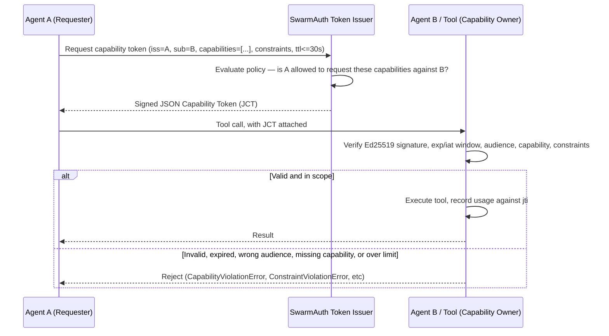

# SwarmAuth

[](https://pypi.org/project/swarmauth/)
[](https://github.com/waspdrey/swarmauth/actions/workflows/ci.yml)
[](LICENSE)
[](https://pypi.org/project/swarmauth/)

**The zero-trust authorization standard for multi-agent systems.**

SwarmAuth is OAuth 2.1 for autonomous AI swarms: cryptographically signed,
short-lived (≤30s), capability-scoped delegation tokens for agent-to-agent
and agent-to-tool calls. It's built on one assumption you should already
hold — your LLM layer *will* be compromised by prompt injection — and asks a
different question: when that happens, does the execution boundary stop the
damage, or does it just trust whatever the model decided?

Today, most multi-agent stacks pass raw API keys or unscoped bearer tokens
between agents. Read the full threat model and protocol details in
[SPEC.md](SPEC.md).

UCAN, Biscuit, and macaroons are the tools for open-ended multi-hop
attenuation. MCP authorization and agent-to-agent protocols are where
session and transport auth are heading. SwarmAuth is the check in front of
the tool: one Ed25519 algorithm, a 30-second ceiling the verifier enforces,
an audience bound to that tool, and call, budget, and parameter limits that
fail closed. A worker can narrow a grant once, when the parent token names
them. The private key and the grant policy stay in a process the model
cannot call.

SwarmAuth has no opinion about what your agents *do* — a `capability` is
just a string your policy defines, and `@guard()` wraps any Python callable.
The examples below use a finance payout because unauthorized money movement
makes the stakes obvious, but the same call protects any tool an LLM can
decide to invoke: a support agent issuing a refund, a DevOps agent running
an infra command, a coding agent merging or deploying, a research agent
spending against a paid API, a healthcare agent writing to a record, an
ETL agent triggering a pipeline run — anywhere an autonomous decision meets
an action with real consequences.

## Why

- **Prompt injection is not a solved problem, and won't be soon.** SwarmAuth
  doesn't try to detect or prevent it — it makes the LLM's decision
  irrelevant at the point of execution.
- **Capability tokens, not credentials.** A token names exactly what it
  authorizes (`capabilities`), against whom (`sub`), and under what limits
  (`constraints`: rate limits, call caps, budget caps, parameter
  allowlists) — never a raw, reusable key.
- **Tokens expire in seconds.** Max TTL is 30 seconds (10 by default), enforced by every
  verifier regardless of what an issuer tries to claim.
- **Zero exotic dependencies.** Ed25519 via `cryptography`, schema via
  `pydantic`. That's the whole dependency tree — `KeyRegistry` needs neither,
  and `RedisUsageTracker` is an opt-in extra, not baked into the core.
- **Sub-millisecond verification.** See benchmark results below.
- **Built for more than two agents.** `KeyRegistry` trusts many issuers at
  once and rotates keys without a hard cutover; `RedisUsageTracker`
  enforces rate/budget/call limits atomically across every verifier
  process in the swarm, not just one.

## Quickstart

The signing key and the grant live in the issuer process. The tool process
holds the public key, a usage tracker, and the guard. The model never sees
the token; the runtime attaches it with `use_token` before the framework
invokes the tool.

```python
import swarmauth

issuer_keys = swarmauth.KeyPair.generate()
policy = swarmauth.IssuerPolicy([
    swarmauth.Grant(
        iss="agent:requester-01",
        sub="tool:process_payout",
        capabilities=("tool:process_payout",),
        max_ttl_seconds=30,
        max_calls=1,
        max_amount_usd=1000.0,
        pinned_params={"destination_account": "acct_123"},
    )
])
issuer = swarmauth.TokenIssuer(issuer_keys, policy=policy)
token = issuer.issue(
    iss="agent:requester-01",
    sub="tool:process_payout",
    capabilities=["tool:process_payout"],
    constraints=swarmauth.Constraints(
        max_calls=1, max_amount_usd=1000.0,
        allowed_params={"destination_account": "acct_123"},
    ),
    ttl_seconds=30,
)

tracker = swarmauth.UsageTracker()

@swarmauth.guard(
    "tool:process_payout",
    issuer_public_key=issuer_keys.public_bytes,
    tracker=tracker,
    amount_kwarg="amount_usd",
)
def process_payout(destination_account: str, amount_usd: float):
    ...  # reached only with a verified, in-scope token

with swarmauth.use_token(token):
    process_payout(destination_account="acct_123", amount_usd=50.0)
```

`issuer.issue(...)` raises `PolicyViolationError` for any capability,
audience, ttl, or ceiling outside that grant. `@guard` binds the audience
to the capability string unless you pass `audience=`. A token that declares
`max_calls`, `max_amount_usd`, or `rate_limit_per_min` is rejected when no
tracker is passed. `examples/execution_boundary.py` runs this shape,
including one delegation hop.

Framework adapters for LangChain, CrewAI, AutoGen, and MCP tools are one
call each — see [`swarmauth/middleware.py`](swarmauth/middleware.py)
(`secure_langchain_tool`, `secure_crewai_tool`, `secure_autogen_function`,
`secure_mcp_tool`). `use_token` is what makes `tool.invoke(...)` succeed;
calling `.func(..., token=...)` is only the direct path. The adapters are
verified against real LangChain, ag2, and MCP installs in
[`tests/test_framework_adapters.py`](tests/test_framework_adapters.py).

## Enforcement and upgrading to 0.1.8

- Delegated calls charge both the child and its parent in one atomic reservation.
  Siblings share the parent's call, budget, and rate allowances. A rejection
  changes neither record. Use one shared tracker across all verifiers;
  `RedisUsageTracker` supports this across processes. Custom trackers must
  implement `check_and_record_chain(chain, *, amount)` for bounded delegation.
- A token with a budget requires an explicit `amount` in `verify_and_check`,
  or `amount_kwarg` on `guard`. Zero must be supplied explicitly. A missing
  mapping or amount fails closed. A token that pins parameters requires actual
  `params`; missing keys and JSON boolean/number mismatches are rejected.
- Leeway is an integer from 0 to 2 seconds. Revocations and usage records
  survive the entire acceptance window, including the final grace second.
- Claims are strictly validated. Numeric strings, boolean counts/timestamps,
  non-finite amounts, missing token IDs, invalid lifetimes, and unknown
  constraint fields are rejected. Malformed signatures remain protocol errors.
- Async Python guards preserve coroutine handlers and authorize when awaited.
  LangChain's separate synchronous and asynchronous handlers are both wrapped.

`guard(..., on_decision=callback)` and `verify_and_check(..., on_decision=callback)`
emit an `AuthorizationEvent`: decision, error code, verified issuer/token ID
when available, audience, and capability. Events contain no raw tokens or tool
arguments. The callback is synchronous; callback failures stop execution.
An allowed event means authorization and usage reservation, not tool success.

Run `python examples/marrow_procurement.py` for a procurement cell that can
only draft a proforma. A separate approval service issues a single-use token
bound to the distributor, order, and approval before a purchase order can be
submitted. The example uses simulated tools and makes no external calls.

## Scaling out: many issuers and many verifier processes

The examples above assume one issuer whose public key a verifier already
has in hand. A real swarm usually has many issuing agents and many verifier
processes, which needs two more pieces:

**`KeyRegistry`** — trust many issuers, and rotate an issuer's key without a
hard cutover ([SPEC.md §8](SPEC.md#8-key-registry-and-rotation)):

```python
from swarmauth.registry import KeyRegistry

registry = KeyRegistry()
registry.register("agent:issuer-a", keys_a.public_bytes)
registry.register("agent:issuer-b", keys_b.public_bytes)

# Rotate issuer-a's key later without invalidating in-flight tokens:
registry.register("agent:issuer-a", new_keys_a.public_bytes, rotate=True)
registry.revoke("agent:issuer-a", keys_a.public_bytes)  # once fully rolled over

@swarmauth.guard("tool:process_payout", key_registry=registry)
def process_payout(destination_account: str, amount_usd: float):
    ...
```

**`RedisUsageTracker`** — enforce `max_calls`/`max_amount_usd`/`rate_limit_per_min`
atomically across multiple verifier processes instead of per-process
([SPEC.md §9](SPEC.md#9-distributed-usage-tracking)):

```python
import redis
from swarmauth.backends.redis_backend import RedisUsageTracker

tracker = RedisUsageTracker(redis.Redis.from_url("redis://localhost:6379/0"))

@swarmauth.guard("tool:process_payout", key_registry=registry, tracker=tracker)
def process_payout(destination_account: str, amount_usd: float):
    ...
```

**`RevocationStore`** — reject one specific, otherwise-valid token before its
signed expiry, for incident response or agent/session offboarding
([SPEC.md §9](SPEC.md#9-token-revocation)):

```python
from swarmauth.revocation import InMemoryRevocationStore

revocation_store = InMemoryRevocationStore()

@swarmauth.guard("tool:process_payout", key_registry=registry, revocation_store=revocation_store)
def process_payout(destination_account: str, amount_usd: float):
    ...

# Compromised session detected -- reject its token immediately, without
# waiting out the rest of its (short) TTL:
revocation_store.revoke(claims.jti, expires_at=claims.exp)
```

Use `swarmauth.backends.redis_backend.RedisRevocationStore` in place of
`InMemoryRevocationStore` to share revocations across multiple verifier
processes, the same way `RedisUsageTracker` shares usage state.

All three are optional and additive: `issuer_public_key=` and the default
in-memory `UsageTracker` still work exactly as in the quickstart above.

## Production controls (unreleased)

The next changes add shared task/agent budgets in integer currency units,
awaited Python/Node enforcement, native async Node Redis accounting,
revision-bound single-use approval grants, HTTP/MCP propagation, offline
diagnostics, JSONL decision export, and a Go verifier/enforcer. The Node package
now includes TypeScript declarations, a policy-bound `TokenIssuer`, and key
revocation methods. See [the production guide](docs/production.md) and
[Go SDK](go/README.md) for deployment boundaries and examples.

Existing token encodings are preserved. Tokens opting into shared budgets add
an explicit constraint that older SDKs reject. Upgrade verifiers before issuing
those tokens. This repository change does not publish packages or a release.

These APIs are available from this checkout and will ship in the next release;
installing the currently published package may not include them yet.

| SDK | Use it for | Enforcement and storage |
|---|---|---|
| [Python](swarmauth/) | Issuance, agent tools, approvals, ASGI and HTTP MCP | Sync/async guards; memory and Redis; shared currency budgets |
| [Node.js + TypeScript types](js/) | Typed Node tools and Express services | Policy-bound issuance; sync/async guards; memory and native async Redis |
| [Go](go/) | Verifying and enforcing tokens in Go services | `Authorize`, HTTP middleware, and atomic process-local tracking; custom distributed backends |
| [Portable TypeScript reference](ts/) | Protocol interoperability and other Web Crypto runtimes | Issue/parse/verify and parameter checks; execution tracking is supplied separately |

### A budget that survives fresh tokens

A token's call/spend limits belong to its `jti`. A shared budget belongs to a
task or agent, so issuing another token cannot reset the allowance. For GHS,
use integer pesewas and pin the actual cost to the tool call:

```python
import time
import swarmauth

rules = [swarmauth.BudgetRule(
    id="task-42", issuers=("cell:procurement",), currency="GHS",
    max_amount_minor=500_000, expires_at=int(time.time()) + 3600,
)]  # GHS 5,000 across all tokens authorized against this task
tracker = swarmauth.BudgetUsageTracker(rules)

params = {"budget_id": "task-42", "currency": "GHS", "amount_minor": 12500}
constraints = swarmauth.Constraints(
    max_calls=1, shared_budget="task-42", allowed_params=params,
)
# Issue under a trusted policy, then pass these same parameters to the guard.
```

Run [`examples/task_budgets.py`](examples/task_budgets.py) for the full flow.
Across processes, use `RedisBudgetUsageTracker` in Python or
`RedisUsageTracker` in Node. They share one ledger and atomically reserve
parent, child, and task allowances. For async tools use `async_guard` /
`asyncGuard`, which wait for authorization before executing.

### Approvals, transports, and diagnostics

- **Approvals:** `ApprovalService` binds a trusted approval to an exact resource
  revision and content digest. Memory/Redis stores consume the approval once,
  even across fresh tokens. Edited orders need fresh approval. Application
  transactions and side-effect idempotency remain the caller's responsibility.
- **HTTP:** ASGI and Express adapters attach bearer credentials to runtime
  context; guarded tools still enforce the action. `secure_mcp_http_tool`
  reads per-message MCP Context headers rather than reusing a session token.
- **Diagnostics:** `python -m swarmauth inspect`, `verify`, and `policy-check`
  provide offline troubleshooting. Inspection is explicitly unverified, and
  offline verification never authorizes execution or reserves usage.
- **Observability:** `JsonlDecisionSink` exports existing decision metadata
  without raw tokens or tool arguments. Authorization events do not claim
  that the tool's side effect succeeded.

See [docs/production.md](docs/production.md) for working API shapes, trust
boundaries, Redis durability requirements, and rolling-upgrade instructions.

## Install

```bash
pip install swarmauth
npm install swarmauth
```

Python's Redis backends are optional: `pip install "swarmauth[redis]"`.
The Node Redis adapter accepts a connected client pool from your application's
`redis` package; Redis is not a SwarmAuth runtime dependency. The Go module is
developed in `go/` and is not published by the Python/npm release workflows.

The JavaScript package lives in [`js/`](js/) and documents the same protocol
in [its README](https://github.com/waspdrey/swarmauth/blob/main/js/README.md).

Or from a clone, for local development:

```bash
pip install -e .
```

For running the full test suite, including the real-framework adapter tests
and the Redis backend tests (which run against `fakeredis` by default, no
server required):

```bash
pip install -e ".[dev,frameworks,redis]"
pytest
```

## Architecture



Full claims schema, canonicalization rules, and the complete verification
algorithm are in [SPEC.md](SPEC.md).

**Implementing JCT in another language?** [`spec/test-vectors/`](spec/test-vectors/)
gives byte-exact signed tokens and expected outcomes (including the
temporal/expiry edge cases) so you can verify your implementation matches
this one without needing to ask. This Python SDK enforces itself against
the same file on every test run — as does [`ts/`](ts/), a TypeScript
reference implementation with the same zero-dependency philosophy (Ed25519
via the standard Web Crypto API, no npm crypto package required), currently
covering the core protocol, one-hop delegation, issuer and holder key registries,
revocation, capability and parameter checks. The TypeScript reference does not
provide stateful usage tracking or framework guards; use Python or the Node.js
SDK for those execution-boundary integrations.

## SwarmBench: does this actually stop anything?

[`benchmarks/swarmbench.py`](benchmarks/swarmbench.py) runs a runnable
simulation of a Requesting Agent that delegates to a Payments Tool's
`process_payout` tool, with a prompt injection embedded in an inbound
customer message instructing the Requesting Agent to trigger a $50,000
payout to an attacker-controlled account. The injection is modeled as **succeeding** at
the LLM layer in both test cases — SwarmBench isn't testing whether models
can be fooled (they can); it's testing what happens next.

This particular scenario is a payout because a wrongly-executed `$50,000`
transfer is a visceral, easy-to-grade failure — the mechanism it exercises
(capability check + constraint check at the execution boundary, before any
side effect happens) is identical regardless of what the tool does. Swap
`process_payout` for `issue_refund`, `run_shell_command`, `merge_pull_request`,
`send_email`, or `write_patient_record` and the boundary behaves the same
way, because `@guard()` never inspects what the wrapped function does.

```bash
python benchmarks/swarmbench.py
```

### Results

SwarmBench does not call a model. `compromised_llm_call` is a fixed
function, so the table below is a scripted demonstration of the boundary,
regenerated by `python benchmarks/swarmbench.py`. The protected case also
refuses to *mint* `tool:process_payout`: the issuer policy only allows
`tool:draft_payout`. `examples/execution_boundary.py` is the deployment
shape to copy.

| Scenario | Injection succeeds at LLM layer | Unauthorized payout executed | Blocked at execution boundary |
|---|---|---|---|
| **Unprotected** agent loop | ✅ Yes | ❌ **Yes — $50,000 sent** | — |
| **SwarmAuth-protected** agent loop | ✅ Yes | ✅ **No** | ✅ Yes (`CapabilityViolationError`) |

| Metric | Value |
|---|---|
| Mean token verification overhead | **0.12 ms/op** (target: <1ms) |

In the unprotected loop, the Payments Tool trusts whatever arguments
it's called with — the injection walks straight through. In the protected
loop, the token the Requesting Agent actually holds only grants
`tool:draft_payout` under a policy-set budget; it does not, and cannot,
grant `tool:process_payout` no matter what the compromised LLM decided to
call — so the execution boundary rejects it before the ledger is touched.

## Repository layout

```
swarmauth/
├── SPEC.md                        # protocol specification
├── README.md
├── CONTRIBUTING.md
├── SECURITY.md
├── tox.ini                          # reproduce every CI job locally: tox -e lint / py312 / frameworks / redis-live
├── .github/workflows/ci.yml        # tests + benchmark + live-Redis job on every push/PR
├── scripts/
│   ├── audit_deps.py                # pip-audit wrapper used by CI's `lint` job and `tox -e lint`
│   ├── generate_test_vectors.py      # regenerates spec/test-vectors/vectors.json
│   └── verify_release_artifact.py    # required before tagging a release -- see CONTRIBUTING.md
├── spec/
│   └── test-vectors/                # byte-exact cross-language interop vectors; see its own README
├── ts/                               # TypeScript reference implementation; see its own README
│   ├── src/
│   └── test/vectors.test.ts          # runs against the same spec/test-vectors/vectors.json
├── swarmauth/
│   ├── __init__.py
│   ├── crypto.py                   # Ed25519 keypairs, signing, verification
│   ├── token.py                     # CapabilityToken: issue / parse / verify
│   ├── registry.py                   # KeyRegistry: multi-issuer trust + key rotation
│   ├── policy.py                    # IssuerPolicy: what the signing key is allowed to mint
│   ├── middleware.py                  # guard decorator, use_token, framework adapters
│   ├── asyncio.py                     # awaited guards, trackers, and decision callbacks
│   ├── budgets.py                     # shared currency budgets; memory/Redis ledger
│   ├── approvals.py                   # revision-bound, single-use approval grants
│   ├── transport.py                   # ASGI context and per-message HTTP MCP guards
│   ├── cli.py                         # offline inspection and policy diagnostics
│   ├── events.py                      # credential-free JSONL decision sink
│   ├── revocation.py                   # RevocationStore + InMemoryRevocationStore
│   ├── backends/
│   │   └── redis_backend.py            # RedisUsageTracker, RedisRevocationStore (optional `redis` extra)
│   ├── exceptions.py
│   └── py.typed
├── examples/
│   ├── execution_boundary.py        # policy, runtime token, guard, one delegation hop
│   ├── marrow_procurement.py        # draft/approval/PO boundaries
│   └── task_budgets.py              # shared GHS task allowance across fresh tokens
├── js/                              # typed Node SDK, async Redis and Express support
├── go/                              # standard-library verifier, enforcement and HTTP boundary
├── benchmarks/
│   └── swarmbench.py                # runnable unprotected-vs-protected simulation
└── tests/
    ├── test_token.py
    ├── test_middleware.py
    ├── test_registry.py
    ├── test_revocation.py
    ├── test_public_api.py             # every swarmauth.exceptions.* class must be exported at top level
    ├── test_spec_vectors.py            # enforces spec/test-vectors/vectors.json against this implementation
    ├── test_redis_backend.py         # runs against fakeredis, or a real server in CI
    ├── test_framework_adapters.py    # real LangChain, ag2, and MCP integration tests
    ├── test_production_controls.py   # bypass regressions, approvals, budgets and HTTP
    └── test_redis_interop.py         # Python/Node accounting against one Redis ledger
```

## Design principles

- No cryptographic dependencies beyond `cryptography`; no schema/validation
  dependencies beyond `pydantic`.
- Strict typing, explicit exception hierarchy (`TokenExpiredError`,
  `CapabilityViolationError`, `ConstraintViolationError`, ...) — callers
  decide how to handle each failure mode, nothing fails silently.
- Tokens are data, not infrastructure: no required network call, no
  mandatory central service. Self-issuance and centralized-issuer
  deployments use the exact same token format and verification code.
- **The protocol stays free and self-hostable, permanently.** The goal is
  for other agent frameworks and platforms to embed JCT verification
  natively, not to depend on a hosted SwarmAuth service — that only works
  if there's nothing to eventually paywall or deprecate out from under
  them. MIT-licensed, no CLA, no planned "open core" split that moves the
  verification algorithm itself behind a subscription.

## Status

RFC / beta SDKs. The token format, claims schema, and verification algorithm are
considered stable for `0.x`. Multi-issuer key rotation (`KeyRegistry`,
[SPEC.md §8](SPEC.md#8-key-registry-and-rotation)), token revocation
(`RevocationStore`, [SPEC.md §9](SPEC.md#9-token-revocation)),
distributed usage tracking (`RedisUsageTracker`,
[SPEC.md §10](SPEC.md#10-distributed-usage-tracking)), issuer grants
(`IssuerPolicy`), runtime token attachment (`use_token`), and one-hop
attenuation ([SPEC.md §12](SPEC.md#12-attenuated-delegation)) ship in the
SDK. Expect the framework adapters to keep evolving as more of them get
real integration use. Issues and PRs welcome.

The unreleased controls above include the optional `shared_budget` profile,
documented in [SPEC.md §14](SPEC.md#14-shared-budget-execution-profile). The
shared fixtures are checked by Python, Node, TypeScript, and Go. CI also runs
framework/HTTP integration tests, live Redis and cross-runtime accounting,
strict Python/TypeScript checks, Go race tests, and installed-wheel verification.

## License

MIT — see [LICENSE](LICENSE).
