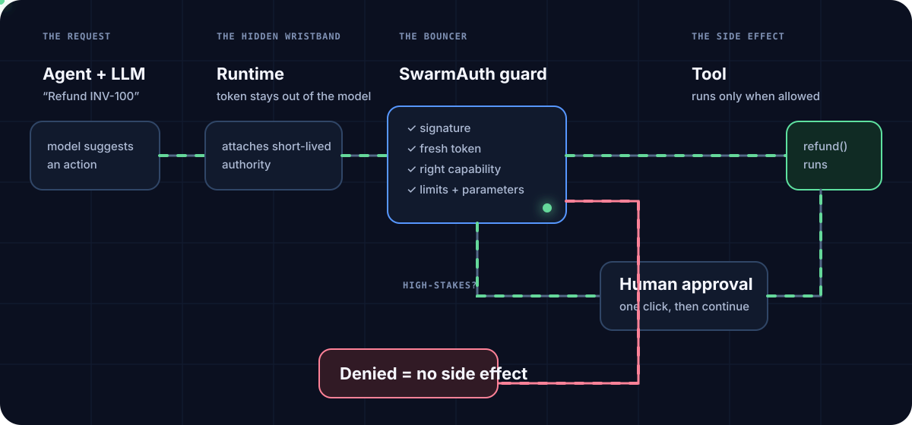

# SwarmAuth

[](https://pypi.org/project/swarmauth/)
[](https://github.com/waspdrey/swarmauth/actions/workflows/ci.yml)
[](LICENSE)

> The LLM can hallucinate. Your money, production cluster, and patient records
> should not have to pay for it.

SwarmAuth is the execution-boundary authorization layer for AI agents. It
turns “the model asked for this” into “this exact agent may call this exact
tool, with these exact limits, for the next few seconds.”

```text
prompt injection → model asks for something wild
                 ↓
          SwarmAuth guard
                 ↓
       allowed / denied before side effect
```

It uses signed, short-lived, capability-scoped tokens. The model never gets a
raw API key, and the tool never trusts the model just because it sounds
confident.

## The 60-second version

```bash
pip install swarmauth
```

```python
import swarmauth

keys = swarmauth.KeyPair.generate()
issuer = swarmauth.TokenIssuer(keys)

token = issuer.issue(
    iss="agent:billing",
    sub="tool:refund",
    capabilities=["tool:refund"],
    ttl_seconds=10,
)

@swarmauth.guard(
    "tool:refund",
    issuer_public_key=keys.public_bytes,
)
def issue_refund(invoice_id: str, amount_usd: float):
    return {"refunded": invoice_id, "amount": amount_usd}

with swarmauth.use_token(token):
    issue_refund("INV-100", 25.00)  # verified, scoped, and then executed
```

The important bit is not the decorator. It is the order of operations:

```text
verify signature → check expiry → bind audience → check capability
→ enforce limits → optionally require a human → call the function
```

If any check fails, the function is not called.

## Architecture: the bouncer in front of the tool

Think of SwarmAuth as a very fast bouncer. The agent can ask to enter. The
tool only opens the door after the bouncer checks the wristband.



_The animation is decorative; the Mermaid diagram below is the readable,
copyable fallback._

```mermaid
flowchart LR
    A[Agent + LLM<br/>"Refund INV-100"] --> R[Runtime<br/>keeps the token hidden]
    R --> G{SwarmAuth guard}

    G --> C1[1. Signature<br/>Is it authentic?]
    C1 --> C2[2. Time<br/>Is it still fresh?]
    C2 --> C3[3. Scope<br/>Right agent, tool, capability?]
    C3 --> C4[4. Limits<br/>Amount, calls, parameters?]
    C4 --> H{High-stakes action?}

    H -- No --> T[Tool runs]
    H -- Yes --> Q[Human approval gate]
    Q -- Approved --> T
    Q -- Rejected or expired --> X[Tool does not run]

    classDef good fill:#183b2b,stroke:#65d89a,color:#fff
    classDef check fill:#172338,stroke:#7db7ff,color:#fff
    classDef stop fill:#3d1d25,stroke:#ff8c9c,color:#fff
    class T good
    class C1,C2,C3,C4 check
    class X stop
```

The model can suggest an action. It cannot skip the guard, mint authority, or
smuggle a token into the tool schema.

| Box | Plain-English job |
| --- | --- |
| Agent + LLM | Suggests what it wants to do. It may be wrong or manipulated. |
| Runtime | Holds the short-lived token and attaches it outside the model's view. |
| Guard | Verifies the request before the real function is called. |
| Human approval | Pauses dangerous actions until an authenticated reviewer decides. |
| Tool | Runs only after every required check passes. |

```text
agent asks → guard checks → maybe human clicks → tool runs
                         ↘ denied = no side effect
```

## Why this exists

LLMs are useful, probabilistic, and extremely good at confidently following
instructions hidden in documents, tickets, webpages, and tool output. That is
not a reason to stop building agent systems. It is a reason to put a hard
boundary around side effects.

SwarmAuth does not try to detect prompt injection. It assumes the model may be
compromised and asks a more useful question:

> Even if the model is wrong, can it still move money, deploy code, delete
> data, or exfiltrate secrets?

The answer should be “only if the runtime authorization says yes.”

## What a token can say

```text
issuer       agent:billing
audience     tool:refund
capability   tool:refund
expires      10 seconds from now
limits       one call, <= $100, invoice_id matches an allowlist
signature    Ed25519
```

Tokens have a verifier-enforced 30-second maximum TTL (10 seconds by default).
Policies can narrow authority further with call counts, budgets, rate limits,
and parameter constraints. A worker can attenuate a grant once when the parent
token explicitly allows delegation.

The private key and grant policy stay in the issuer process. The model gets
neither.

## Make the quickstart real

An issuer policy prevents the issuer from minting something it should not be
able to mint. A usage tracker makes a one-call or budget constraint stateful.

```python
policy = swarmauth.IssuerPolicy([
    swarmauth.Grant(
        iss="agent:billing",
        sub="tool:refund",
        capabilities=("tool:refund",),
        max_ttl_seconds=30,
        max_calls=1,
        max_amount_usd=100.0,
    )
])

issuer = swarmauth.TokenIssuer(keys, policy=policy)
token = issuer.issue(
    iss="agent:billing",
    sub="tool:refund",
    capabilities=["tool:refund"],
    constraints=swarmauth.Constraints(max_calls=1, max_amount_usd=100.0),
    ttl_seconds=30,
)

tracker = swarmauth.UsageTracker()

@swarmauth.guard(
    "tool:refund",
    issuer_public_key=keys.public_bytes,
    tracker=tracker,
    amount_kwarg="amount_usd",
)
def issue_refund(invoice_id: str, amount_usd: float):
    ...
```

Try the runnable version:

```bash
python3 examples/execution_boundary.py
python3 benchmarks/swarmbench.py
```

## When a human should click

For the genuinely spicy actions—large refunds, production deploys, deleting
customer data—put a human in the loop:

```python
gate = swarmauth.ApprovalGatekeeper(
    secret=approval_secret,
    base_url="https://review.example.com",
)

request = gate.request(
    action="issue_refund",
    capability="tool:refund",
    subject="agent:billing",
    requester="billing-agent",
    summary="Refund INV-100 for $2,500",
)

# Render and deliver to Slack, email, Teams, PagerDuty, or your own webhook.
gate.notify(request, swarmauth.SlackApprovalChannel())

# The link is signed, expiring, and single-use.
# The action must call require_approved() before its side effect.
gate.require_approved(request.request_id)
```

The SDK includes Slack Block Kit, email, and generic webhook payload
renderers, plus `ApprovalHTTPApp` for resolving the signed link. They do not
silently pretend to be a Slack app or an email provider: you connect delivery
through your existing systems. The HTTP endpoint requires an authenticated
reviewer identity (`REMOTE_USER`) by default; anonymous signed links are an
explicit pilot-only opt-in. The approval core never receives a
bearer token and fails closed on tampering, expiry, replay, or an unapproved
request.

For real delivery, use `SlackWebhookChannel` or `SMTPEmailChannel` and keep
provider credentials in your secret manager:

```python
gate.notify(request, swarmauth.SlackWebhookChannel(slack_webhook_url))
gate.notify(
    request,
    swarmauth.SMTPEmailChannel(
        "smtp.example.com",
        sender="security@example.com",
        recipients=("oncall@example.com",),
        username=smtp_username,
        password=smtp_password,
    ),
)
```

See [`examples/approval_integrations.py`](examples/approval_integrations.py)
for the environment-variable wiring.

The review endpoint can run as its own small service behind SSO:

```bash
export SWARMAUTH_APPROVAL_SECRET='use-a-secret-manager-and-32-plus-random-bytes'
export SWARMAUTH_REVIEW_BASE_URL='https://review.example.com'
export SWARMAUTH_APPROVAL_DB='/var/lib/swarmauth/approvals.db'
gunicorn swarmauth.approval_wsgi:application
```

The reverse proxy must provide the authenticated reviewer as `REMOTE_USER`.

## Frameworks and protocols

The execution boundary works with ordinary Python callables and has adapters
for common agent-tool shapes:

- LangChain
- CrewAI
- AutoGen / ag2
- MCP tools

The runtime token is injected with `use_token`, so the model-visible tool
schema does not grow a suspicious `token` argument. For OAuth-backed systems,
your resource server validates the incoming credential and
`use_oauth_bearer_token` carries the resulting short-lived JCT to the guard.

```python
with swarmauth.use_oauth_bearer_token(
    request.headers,
    validate=oauth_resource_server.validate_and_mint_jct,
):
    guarded_mcp_tool(invoice_id="INV-100")
```

Start with [`examples/mcp_oauth_reference.py`](examples/mcp_oauth_reference.py)
and [`swarmauth/middleware.py`](swarmauth/middleware.py).

## Evidence, not vibes

Every guard can emit safe allow/deny decision metadata for logs, a SIEM, or a
control plane. Tokens and private keys are deliberately excluded.

```python
sink = swarmauth.JsonlDecisionSink(".local/decisions.jsonl")
guarded = swarmauth.secure_mcp_tool(
    process_refund,
    capability="tool:refund",
    issuer_public_key=keys.public_bytes,
    on_decision=sink,
)
```

```bash
python3 examples/decision_viewer.py .local/decisions.jsonl
```

Decision evidence answers the questions operators actually ask at 2 a.m.:
who called what, under which capability, with which token ID, and why did the
boundary allow or deny it?

## Control plane: the useful bits

The SDK includes a dependency-light governance core for pilots:

```python
plane = swarmauth.ControlPlane()
plane.register_agent("agent:billing", owner="team-finance", public_key=keys.public_bytes)
plane.register_tool("tool:refund", owner="team-finance", capabilities=("tool:refund",))
```

It includes agent/tool registration, revocation, decision evidence, SQLite
persistence, tenant scoping, RBAC, OIDC principal resolution, backups, and an
authenticated WSGI boundary. The local server is intentionally loopback-only
and unauthenticated; do not put it on the internet.

For a small OIDC-backed pilot:

```bash
pip install 'swarmauth[oidc,server]'
export SWARMAUTH_OIDC_ISSUER='https://idp.example.com/'
export SWARMAUTH_OIDC_AUDIENCE='swarmauth-control-plane'
export SWARMAUTH_OIDC_JWKS_URL='https://idp.example.com/.well-known/jwks.json'
export SWARMAUTH_CONTROL_PLANE_DB_DIR='/var/lib/swarmauth'
gunicorn swarmauth.control_plane_wsgi:application
```

See [`examples/control_plane_server.py`](examples/control_plane_server.py),
[`examples/control_plane_oidc_wsgi.py`](examples/control_plane_oidc_wsgi.py),
and [`docs/THREAT_MODEL.md`](docs/THREAT_MODEL.md).

## Scaling beyond one process

The defaults are intentionally boring and local. When the swarm grows:

```python
from swarmauth.registry import KeyRegistry
from swarmauth.backends.redis_backend import RedisUsageTracker

registry = KeyRegistry()
registry.register("agent:billing", billing_public_key)
registry.register("agent:shipping", shipping_public_key)

tracker = RedisUsageTracker(redis_client)

@swarmauth.guard(
    "tool:refund",
    key_registry=registry,
    tracker=tracker,
)
def issue_refund(invoice_id: str, amount_usd: float):
    ...
```

`KeyRegistry` handles many issuers and rotation. Redis backends share usage
limits and revocations across verifier processes. Both are opt-in extras.

## Install the SDKs

```bash
pip install swarmauth
npm install swarmauth
```

The JavaScript and TypeScript implementations use the same protocol and test
vectors:

- [`js/README.md`](js/README.md)
- [`ts/`](ts/)
- [`spec/test-vectors/`](spec/test-vectors/)

For local development:

```bash
pip install -e ".[dev,frameworks,redis]"
pytest
cd ts && npm test
cd ../js && npm test
```

## Does it actually stop anything?

`SwarmBench` gives an agent a prompt injection that asks for a $50,000 payout.
The injection succeeds in both scenarios. The difference is the execution
boundary:

| Scenario | Injection succeeds | Unauthorized payout | Boundary result |
| --- | ---: | ---: | --- |
| Unprotected loop | yes | yes | too late |
| SwarmAuth loop | yes | no | denied before side effect |

This is a scripted benchmark, not a claim that a model was magically made
safe. The protected path rejects the call because the agent only holds a
grant for `tool:draft_payout`, not `tool:process_payout`.

```bash
python3 benchmarks/swarmbench.py
```

## The protocol, for people who enjoy the sharp edges

SwarmAuth is deliberately small: Ed25519 signatures, canonical JSON, a
verifier-enforced TTL ceiling, explicit audiences, capabilities, constraints,
and one-hop attenuation. It is not an OAuth authorization server, a prompt
injection detector, or a replacement for your IdP.

If you are implementing another language, start with:

- [`SPEC.md`](SPEC.md) — claims, canonicalization, verification algorithm
- [`spec/test-vectors/vectors.json`](spec/test-vectors/vectors.json) — byte-exact
  interoperability cases
- [`docs/THREAT_MODEL.md`](docs/THREAT_MODEL.md) — trust boundaries and limits

## Repository map

```text
swarmauth/              Python SDK and execution boundary
  token.py              issue / parse / verify capability tokens
  middleware.py         guards, context, framework adapters
  approvals.py          human approval gate + channel payloads + SQLite store
  approval_http.py      identity-aware one-click approval endpoint
  control_plane.py      registry, tenants, RBAC, SQLite evidence
  oidc.py               JWKS-backed principal resolution
ts/                     TypeScript reference implementation
js/                     JavaScript implementation
spec/test-vectors/      cross-language protocol vectors
examples/               runnable integration shapes
benchmarks/             prompt-injection boundary simulation
docs/                   threat model and design-partner brief
```

## Status

The protocol and SDKs are usable and tested. The control plane, approval
gate, and deployment examples are pilot-grade building blocks—not a hosted
SaaS with managed Slack/email delivery, SSO administration, migrations, and
enterprise operations included for free.

That is intentional. Start with one consequential tool, measure prevented
loss and review time, then earn the next layer.

## License

MIT. See [LICENSE](LICENSE).
